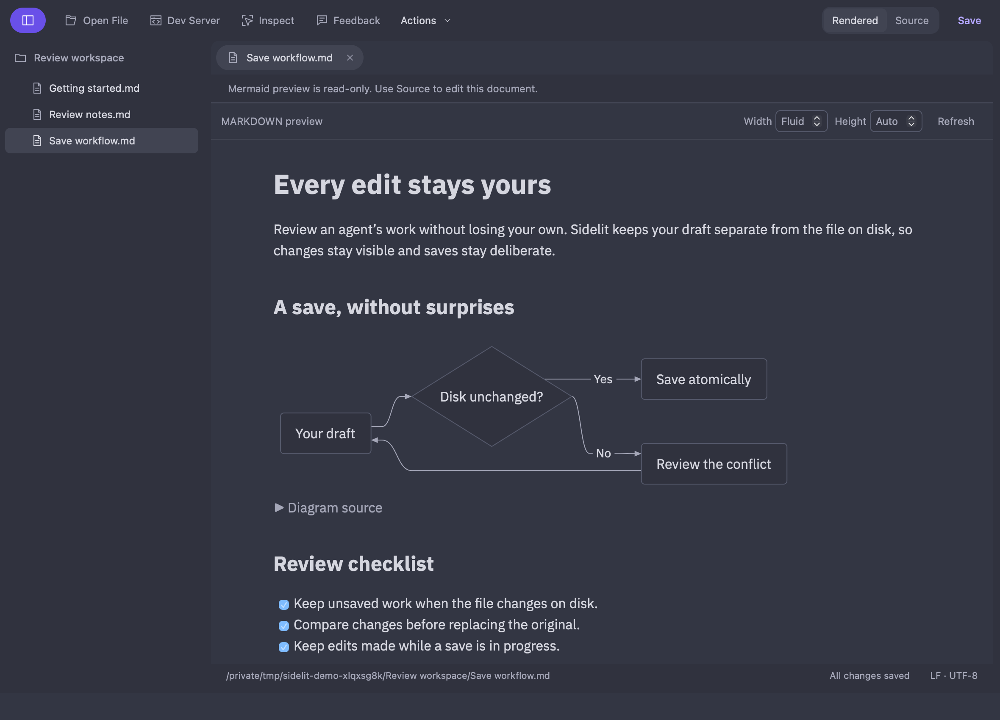
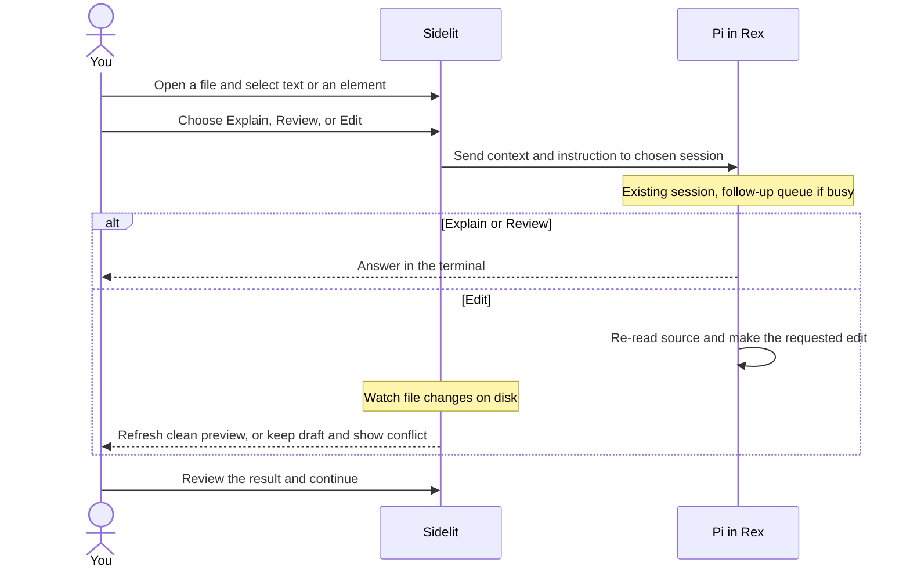

# Sidelit

**Keep your agent in the terminal. Review its work visually.**

Sidelit is a desktop companion for terminal-agent work. Read a plan, document, diagram, or page as it will appear—not just as source. Select what needs attention and send an **Explain**, **Review**, or **Edit** request to your existing Pi session.

Keep Pi in Rex and your code in Neovim. Sidelit adds the review window, not another IDE or chat interface.



## Why Sidelit?

- **Review the result, not only the diff.** Read Markdown and Mermaid diagrams, preview HTML and MDX, or inspect a page from your local development server.
- **Point instead of copying context.** Select a passage or click an element. Sidelit attaches the captured context to your request, so Pi knows what you mean by “this.”
- **Continue the same conversation.** Send to the Pi session already working on the project. If it is busy, the request joins its follow-up queue. Answers stay in Pi; **Show in Rex** returns to the linked terminal.
- **Keep your own edits.** File changes refresh clean documents. Unsaved drafts stay intact and get a conflict view instead of being silently replaced. Saving is explicit.

Sidelit is useful when an agent produces something you need to **read, question, or refine**: a proposal, architecture diagram, generated documentation, or HTML/MDX prototype. It also works as a standalone document viewer and editor; Pi enables the feedback loop, and Rex adds terminal discovery and focus.

## The review loop

Ask Pi to write or update a file, then open it in Sidelit:

```sh
sidelit docs/plan.md
```

Select text or use **Inspect** to pick an element. Choose what you need:

| Action | Ask Pi to… | Example |
| --- | --- | --- |
| **Explain** | Answer a question about the selection | “Why does this step need a queue?” |
| **Review** | Report findings and suggestions | “What failure cases does this plan miss?” |
| **Edit** | Make a specific change to the source | “Add the missing retry path.” |

Choose the intended Pi session, then **Send to Pi**. Edit requests require a change instruction; a question or review focus is optional for Explain and Review.



**Received** or **accepted** means delivery, not completed work. Explain and Review request answers without file edits; they are instructions to Pi, not an edit-permission boundary. Save or resolve unsaved work before requesting an edit—Pi can read the disk file, not your in-memory draft.

## Get started

**[Download Sidelit for macOS](https://github.com/heath0xFF/sidelit/releases/latest)** — macOS 13+, Apple Silicon and Intel in one universal installer. No Node, pnpm, or Rust is needed to run it. Intel runtime testing is still pending.

1. Open the DMG and drag **Sidelit** into **Applications**.
2. Launch Sidelit and open a document. For terminal use, [add `sidelit` to PATH](docs/user-guide.md#install-the-command-on-path).
3. To connect Pi, install the bundled integration:

```sh
sidelit setup --pi --skill
```

In your intended Pi session, run `/reload`, then `/sidelit-status`. Open a file from that project and send your first request. Setup preserves custom installations and does not start another agent or type into your terminal. No Rex plugin is needed.

If no session appears, run `sidelit doctor --project .` from the project directory. See [Pi and Rex setup](docs/user-guide.md#pi-and-rex-setup) for discovery and troubleshooting.

**macOS first-launch note:** releases are ad-hoc signed, not Apple-notarized. For a trusted download, use **System Settings → Privacy & Security → Open Anyway** if macOS blocks it. Do not disable Gatekeeper. Installed versions 0.1.1+ can use **Actions → Check for Updates → Install & Restart**; 0.1.0 needs one manual DMG upgrade.

## What to know

- **Your files stay yours.** Local files are the shared interface. The app uses Tauri/Rust and the OS webview, without Electron or a Node sidecar. Local previews work offline; Pi's model connection is separate.
- **Reading and editing are separate.** Ordinary Markdown has an explicit local **Edit** mode. Markdown with Mermaid diagrams is read-only in Rendered; use **Source** to edit it. This is separate from asking Pi to Edit.
- **Preview scope is deliberate.** Standalone MDX imports need your development server. Server inspection requires the opt-in bridge. Static HTML/MDX and diagrams run in an isolated preview, not the privileged app view.
- **One request at a time.** Hide or change tabs without losing the request. It stays in memory until app exit; there is no batch review queue. Recovery is opt-in and separate from originals, not a backup.

## Go deeper

- [User guide](docs/user-guide.md): shortcuts, preview setup, conflicts, recovery, security, and limits.
- [Development](docs/development.md): build, architecture, and test instructions.
- [Verification](VERIFICATION.md) · [Release process](RELEASING.md) · [Roadmap](ROADMAP.md)
- [Agent skill](skills/sidelit/SKILL.md) · [Pi extension](extensions/pi-sidelit/README.md)

[MIT licensed](LICENSE). Dependency and bundled font notices are retained. **Sidelit is a working name.**
