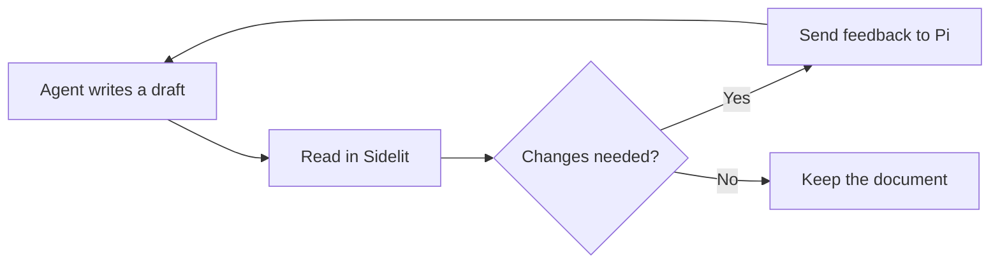
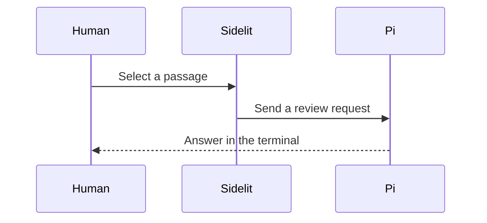

# Review the flow

This document uses a read-only Mermaid preview. Use **Source** to change the prose or diagram code. Previewing and changing the theme must not change the file.

## From draft to review



## A review request



## If a diagram cannot render

The source stays available with an error. This example is intentionally invalid.

```mermaid
not a diagram
```
