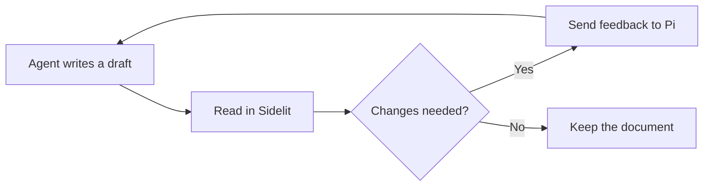
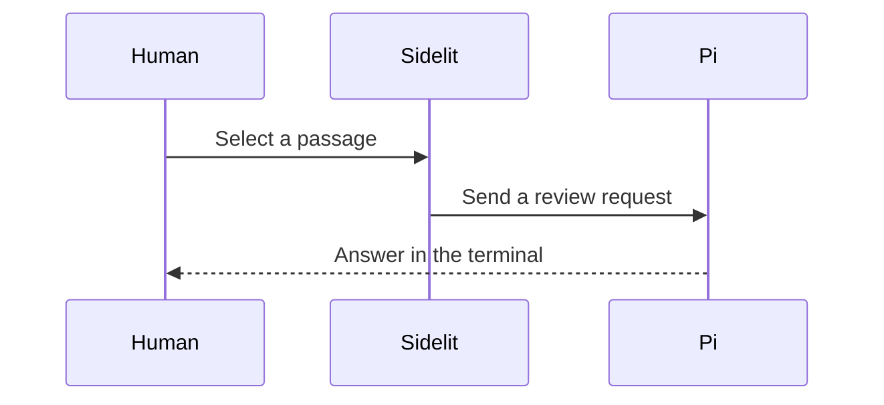

# Review the flow

Diagrams draw in the rich editor. Choose **Edit** to change the prose or a diagram.

## From draft to review



## A review request



## If a diagram cannot render

The block shows an error and keeps its source. This example is intentionally invalid.

```mermaid
not a diagram
```
